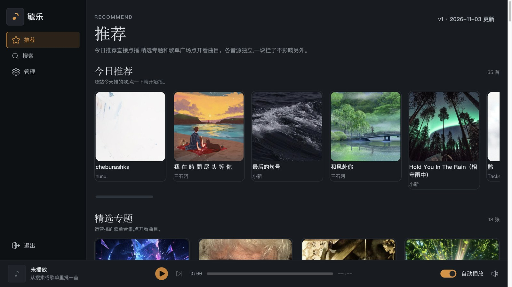
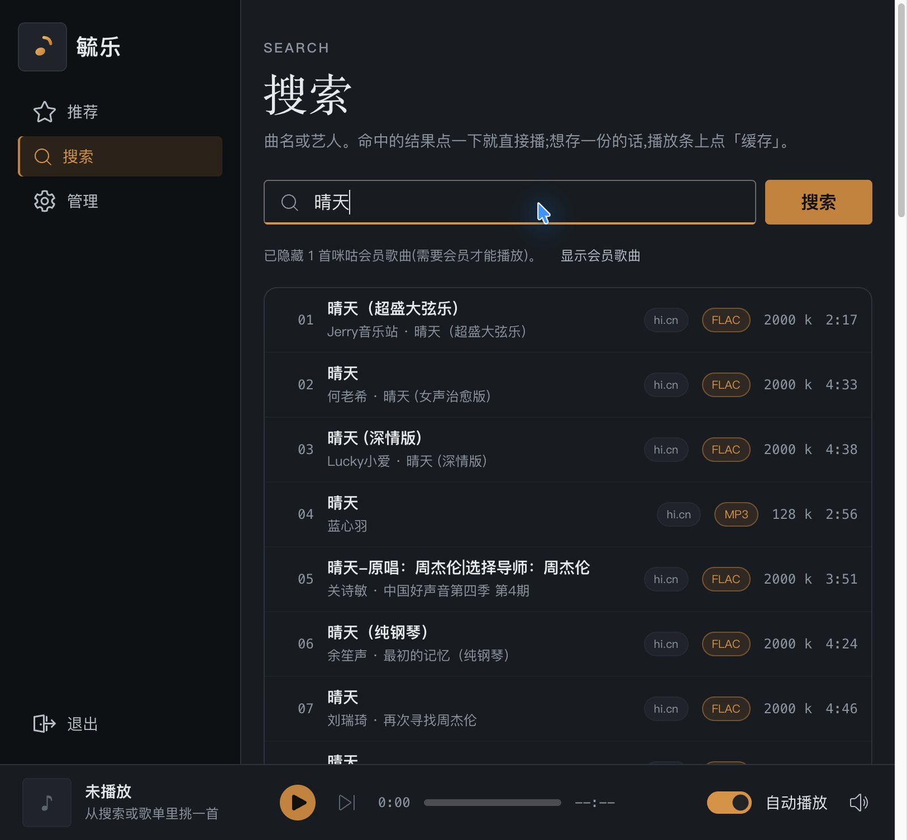
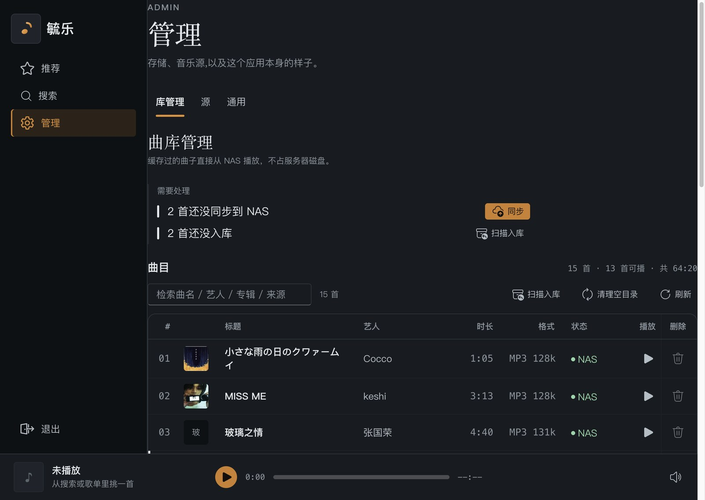
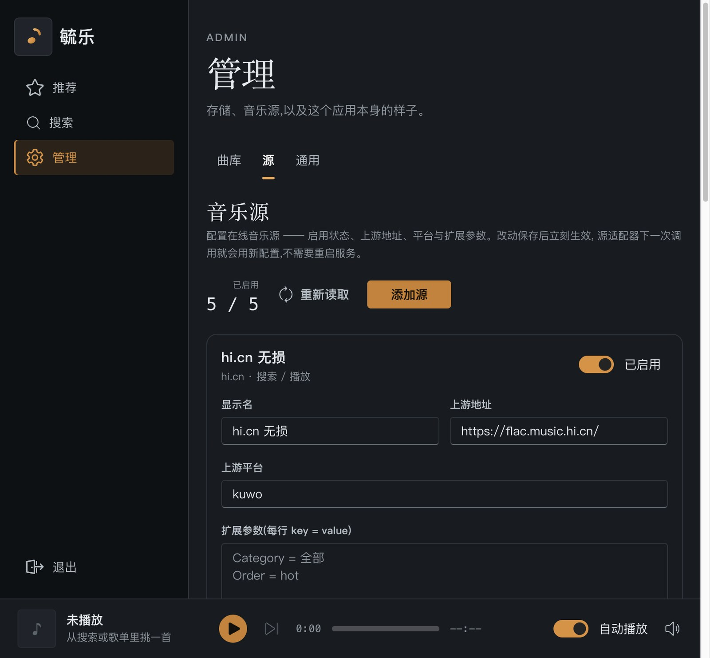
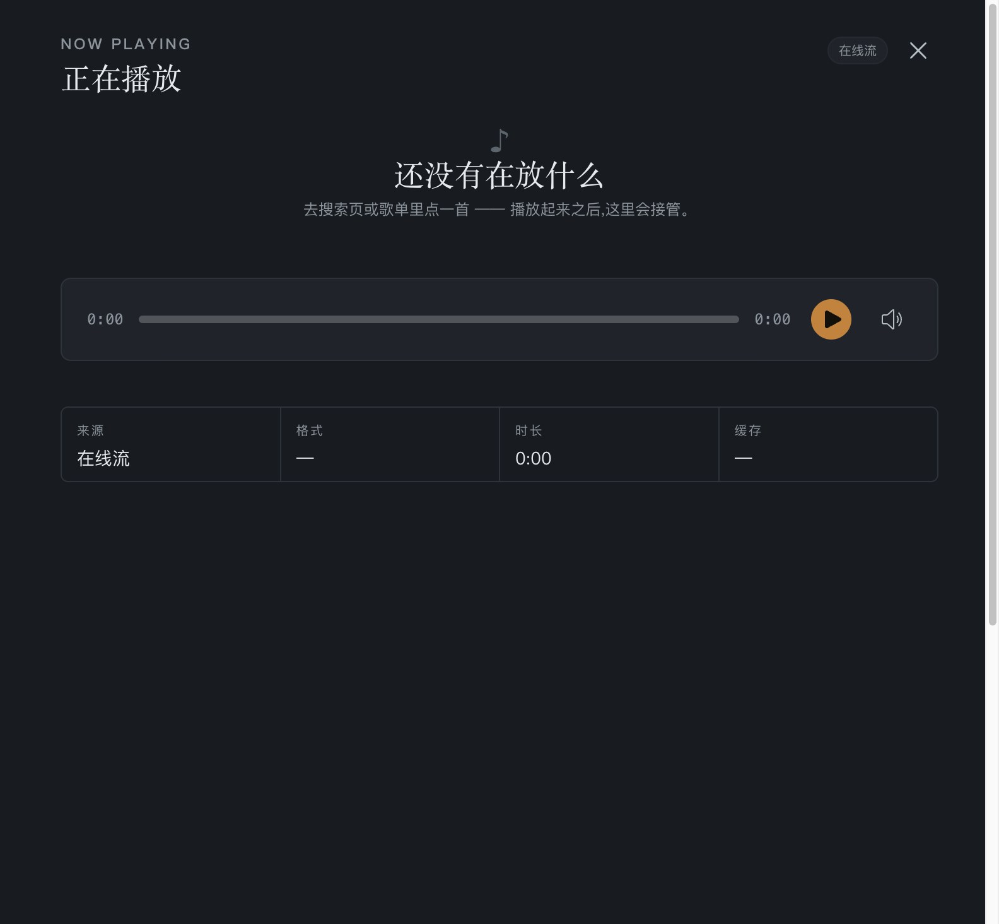
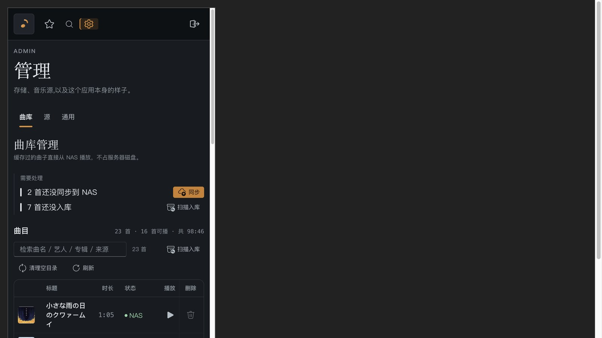

# Yu.Music

**Turn the music on your NAS into a website you can search, stream and download losslessly from.**
Chinese UI, works in any browser on phone or desktop. Library, covers, lyrics and the play queue all live locally — no subscription service required.

> Five music sources are built in (Migu, hi.cn, indie.cn, NetEase, Gequbao) — it works out of the box.
> The code and configuration in the image are obfuscated; there is no readable source to dig out.



*Daily picks + curated collections. Each source stands alone — one being down doesn't take the others with it.*

---

## Why

- **Your music, your rules** — the library is the files on your own NAS, not some app's private folder. New phone, new laptop, the whole family can use it.
- **No monthly fee** — deploy once, use it for years. Sources are replaceable: if one stops working, add your own in the Sources page — no code change, no waiting for a release.
- **Quality is not downgraded** — FLAC lossless is supported (Migu SQ quality).
- **Listen from anywhere** — outside your home network too: the container can mount your NAS over Synology's QuickConnect domain.

## Who it's for

| You | What you get |
|---|---|
| You have a NAS full of music | A music site the whole family can use — much nicer than your NAS's built-in web player |
| You are tired of apps locking your library or your bitrate | Lossless streaming + a local library; the files always stay yours |
| You want to build something for the family | Chinese UI, dark mode, usable on a phone — nothing to teach |
| You make music or collect independent releases | The indie.cn source is dedicated to independent music releases |

---

## Running it in five minutes

### Option 1: one command (try this first)

```bash
docker run -d \
  --name yu-music \
  -p 5106:80 \
  -v yu-music-data:/data \
  -e YuMusic__Admin__Password='<a password you pick>' \
  --restart unless-stopped \
  ghcr.io/zhongbiran/yu-music:latest
```

Open <http://localhost:5106> and you're in.

> `5106` is the port you chose — change it freely. `-v yu-music-data:/data` is the data volume
> (library database + audio cache). **Don't lose it** — remove the volume and the library is gone.
>
> ⚠️ Inside the container the password variable is `YuMusic__Admin__Password` (.NET's config
> convention, two underscores). With compose you don't need to care — the compose file above
> already maps `.env`'s `YU_ADMIN_PASSWORD` onto it. **Leaving it out means the admin page opens
> without a password** — never do that on a machine reachable from the internet.

### Option 2: compose (use this if you attach a NAS or share it with others)

```yaml
# docker-compose.yml
services:
  music:
    image: ghcr.io/zhongbiran/yu-music:latest
    container_name: yu-music
    ports:
      - "5106:80"
    volumes:
      - ./data:/data
    environment:
      # Admin page password. Leave empty = no password needed to open the admin page
      # (fine on a home LAN only).
      YU_ADMIN_PASSWORD: "${YU_ADMIN_PASSWORD:-}"
    restart: unless-stopped
```

```bash
docker compose up -d
```

---

## Three things to do after the first run

### 1. Set an admin password

Out of the box the admin page opens **without a password** (it can edit the library, the sources and the settings).

If this machine isn't on your home LAN — or you just want peace of mind — go to
**Admin › General › Password** and set one. Setting a password invalidates every existing login immediately; log back in with the new one.

> This is deliberate: changing the password kills the old one and all active tokens.

### 2. Check the sources

**Admin › Sources** lists the five built-in sources:

| Source | Search | Stream | Notes |
|---|---|---|---|
| Migu Music | ✅ | ✅ | FLAC lossless / 320K / 128K with automatic fallback; **needs a mainland-China egress IP** |
| hi.cn Lossless | ✅ | ✅ | Leans lossless |
| indie.cn | — | ✅ | No keyword search — go through the Browse page; includes lyrics |
| NetEase Cloud Music | — | — | Recommendations only (playlists, daily picks) |
| Gequbao | ✅ | ✅ | MP3 only; **needs the separate fetcher service** (see below) |

**Why Migu sometimes finds nothing**: Migu returns only metadata (error code `440001`) for non-mainland IPs.
The container uses the host's egress, so a host inside China is fine.

### 3. Decide where downloaded lossless files live

By default they land in `/data/media` inside the container (your data volume).
To have them appear directly on your NAS, see [Connecting a Synology NAS](#connecting-a-synology-nas).

---

## Connecting a Synology NAS

Two ways; **SMB wins** (it works both on and off your LAN).

### NFS (only when you're home, on the same LAN as the NAS)

Export the folder first (Control Panel → Shared Folder → Edit → NFS permissions), then:

```yaml
environment:
  MEDIA_NFS: "192.168.1.28:/volume1/music/YuMusic"
```

### SMB (also works from outside your home)

Synology's DSM web port only listens on IPv4, so WebDAV doesn't work while you're away.
SMB does listen on IPv6, and Synology's **QuickConnect domain** resolves to its current IPv6 address.

Get the domain from Synology's **Control Panel → Log In Portal → QuickConnect**:

```yaml
environment:
  MEDIA_SMB: "//<your-quickconnect-domain>/music"
  MEDIA_SMB_USER: "<synology-user>"
  MEDIA_SMB_PASS: "<synology-password>"
  # The real cache folder inside the share (if the share root holds other music folders)
  MEDIA_SMB_SUBDIR: "YuMusic"
```

> Keep the password in these two variables only — never in a file that ends up in git.

The container also needs mount privileges:

```yaml
cap_add:
  - SYS_ADMIN
  - DAC_READ_SEARCH
  - LINUX_IMMUTABLE
networks:
  default:
  nas:
    enable_ipv6: true
    ipam:
      config:
        - subnet: fd00:dead:beef::/64
```

---

## Configuration reference

Everything is passed as environment variables (names starting with `YuMusic__` are .NET configuration sections).

| Variable | Default | Description |
|---|---|---|
| `YU_ADMIN_PASSWORD` | empty | Admin page password. Empty = no password required |
| `MEDIA_NFS` | empty | `192.168.1.28:/volume1/music/YuMusic` |
| `MEDIA_SMB` | empty | `//<quickconnect-domain>/music` |
| `MEDIA_SMB_USER` / `MEDIA_SMB_PASS` | empty | Synology credentials |
| `MEDIA_SMB_SUBDIR` | empty | Sub-folder inside the share |
| `YuMusic__Migu__BaseAddress` | built-in | Override the Migu endpoint (rarely needed) |
| `YuMusic__Indie__BaseAddress` | built-in | Override the indie.cn endpoint |
| `YuMusic__Gequbao__FetcherBaseAddress` | `http://fetcher:8080/` | Where the fetcher service lives |

---

## Optional: the Gequbao fetcher

The Gequbao source sits behind Cloudflare's **managed challenge** — ordinary HTTP clients
(curl, every scraper library) get a 403 and a "Just a moment…" page. Only a real browser gets through.

So scraping it needs a separate small container with headless Chromium. It serves that one source only —
**skip it entirely if you don't need Gequbao.**

```yaml
# add this to docker-compose.yml
  fetcher:
    image: ghcr.io/zhongbiran/yu-music:fetcher
    container_name: yu-music-fetcher
    environment:
      GEQUBAO_BASE: "https://www.gequbao.com"
    ipc: host
    restart: unless-stopped
```

> That image is 2.6 GB (Chromium). If the size bothers you, use the 350 MB main image alone —
> Migu, hi.cn, indie.cn and NetEase all work without it.

---

## What's in the interface

- **Browse** — daily picks, curated collections, playlist square; indie.cn releases live here too
- **Search** — by title, artist or album; songs already in your library are ranked first and play instantly
- **Admin › Library** — three blocks: **Needs attention** (pending sync / not imported / failed cache, each with its own action button), **Tracks** (cover, status, duration), **Storage** (how much is local vs. on the NAS)
- **Admin › Sources** — inspect built-in sources, add your own, change addresses; **no code change, no waiting for a release**
- **Admin › General** — theme (light/dark), app title, admin password, home-screen notices
- Bottom player bar — previous / next / autoplay / progress / bitrate; it trims itself on phones
- One single address (`/admin`) — **the URL never reveals which page you're on**

### Search: every source at once, format and bitrate at a glance



*Click a result to play it right away; hit "缓存" (cache) on the player bar to keep a copy.*

### Library: what needs doing first, then the track list



*"Needs attention" and the track list below are the same data — click one up there and its row lights up down here.*

### Sources: swap them without writing code



*Address, platform and extra parameters are all editable on the page. Saving takes effect immediately — no restart.*

### How to read the status (legend)

| Marker | Meaning |
|---|---|
| 🟢 green dot | Ready — cached to the NAS (or locally), playable |
| ⚪ grey dot | Nothing to do — not cached yet, but nothing is wrong |
| 🔴 red dot | Something failed — the download or sync broke; click it for the reason |
| Bar on the left of a track row | This one needs you (pending sync / not imported / failed cache) |

> Colours only carry *status*, never *good or bad*. "Needs you" is signalled by position (the bar on the left), not by hue — so it still works if you can't tell the colours apart.

### Now playing: everything in one drawer



### And on a phone



*Same address. The layout switches to a narrow view and the player bar keeps only what matters.*

---

## Security

**The code inside the image is obfuscated:**

- Frontend JS: identifiers renamed to meaningless names, strings rc4-encrypted, **no source maps** (source maps would hand over the source outright)
- Backend DLLs: types/methods/fields renamed, strings encrypted
- No pdb files, no plaintext upstream endpoints, none of your configuration

**But please note:**

- No password means **anyone who can reach the service can open the admin page** (delete tracks, change the NAS, change settings). **Always set a password before exposing it to the internet.**
- For public access, put a reverse proxy with HTTPS in front (Traefik / Caddy / Nginx all work) instead of exposing 5106 directly.
- Obfuscation only raises the cost of reading the source — it is **not a legal protection**.

---

## FAQ

**502 or a blank page**
The backend is still starting (first run installs dependencies and creates the database). Wait 30 seconds and reload, or check `docker logs yu-music`.

**Songs show up but won't play**
Usually the source can't hand out an audio URL. Try another source; for Migu also check the host is on a mainland-China egress.

**The NAS won't mount**
`docker logs` says why. Note that SMB mounting needs the `SYS_ADMIN` capability and a network with IPv6 enabled.

**I set a password and can't get in**
Passwords are stored encrypted in the library database. If you lose it, delete `db/yu-music.db` in the data volume and start over (the library will be empty and tracks need re-scanning).

**It looks cramped on my phone**
The player bar trims itself on narrow screens and the admin tables reflow.

---

## Image details

| | |
|---|---|
| Image | `ghcr.io/zhongbiran/yu-music` |
| Tags | `latest` (main service, ~350 MB), `fetcher` (scraper service, ~2.6 GB) |
| Architectures | `linux/amd64`, `linux/arm64` |
| Port | `80` inside the container — map it to whatever you like |
| Data | `/data/db` (library), `/data/media` (audio cache) |

---

## Credits

- [Fluent UI 2](https://fluent2.microsoft.design/) — the interface framework
- [LiteDB](https://www.litedb.org/) — the embedded database
- [.NET](https://dotnet.microsoft.com/) / [nginx](https://nginx.org/) / [Playwright](https://playwright.dev/)
- The music sites themselves and their rights holders

## A note

This is a personal tool. The built-in sources reach out to third-party sites and scrape their data —
please decide for yourself whether your use complies with those services' terms. The audio you download
belongs to its respective rights holders.
