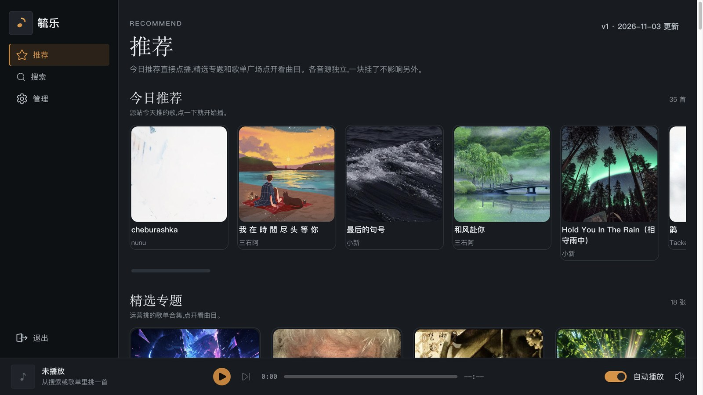
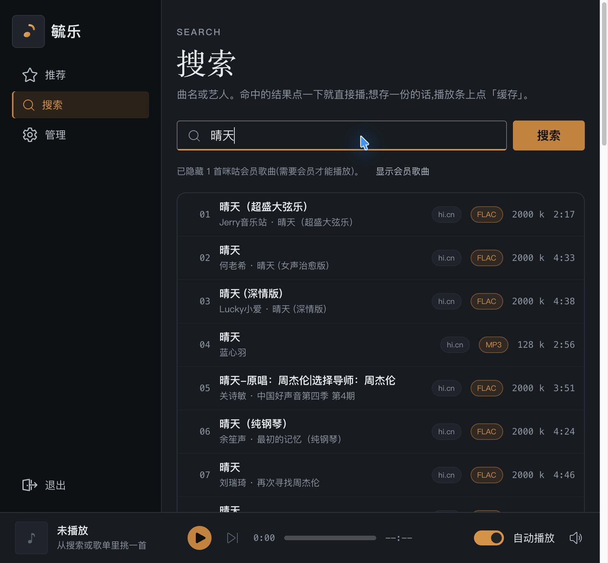
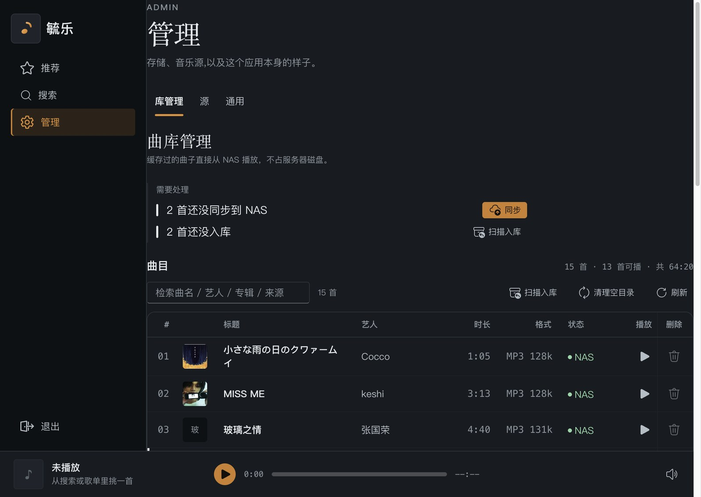
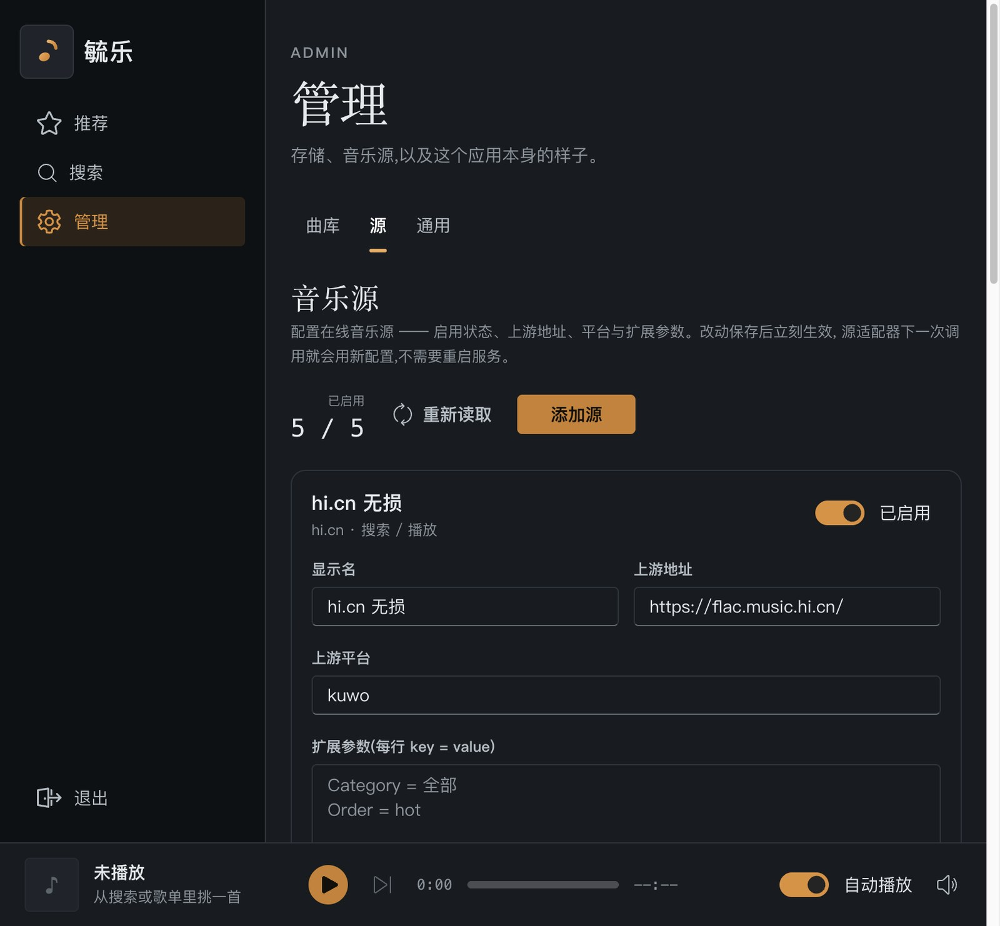
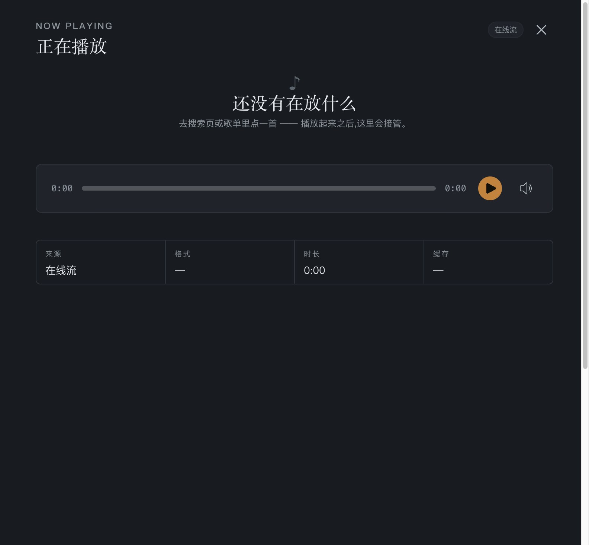

# Yu.Music

**把 NAS 里的音乐变成一个能搜、能播、能下载无损的网页。**
自带中文界面，手机和电脑打开浏览器就能用；曲库、封面、歌词、播放队列全在本地，不依赖任何订阅服务。

> 镜像里已经内置了一些开源音源。
> **代码和配置都做了混淆处理**。



*今日推荐 + 精选专题，各音源独立，一块挂了不影响另外。*

---

## 为什么做它

- **自己的音乐想怎么听就怎么听** —— 曲库是你 NAS 上的文件，不是某个 App 的私有目录。换手机、换电脑、家里人都能用。
- **不用按月付费** —— 一次部署，长期用。音源是可替换的，哪天某个源不好用了，在「源」页面加一个自己的就行，不用等作者发版。
- **音质不被降级** —— 支持 FLAC 无损直取（如果源存在）。
- **在哪都能听** —— 人在外面也能连
- **容器可以走群晖的 QuickConnect **

## 适合谁

| 你 | 能得到什么 |
|---|---|
| 家里有 NAS、存了一堆音乐 | 一个全家都能用的音乐站，界面比群晖自带的网页播放器好用得多 |
| 嫌各家的音乐 App 锁音质、锁曲库 | 无损直取 + 本地曲库，文件始终在你手里 |
| 想给家人做点东西 | 中文界面、深色模式、手机上也能用，不用教 |
| 自己写音乐/整理独立音乐  |

---

## 五分钟跑起来

### 方式一：一条命令（推荐先用这个试试）

```bash
docker run -d \
  --name yu-music \
  -p 5106:80 \
  -v yu-music-data:/data \
  --restart unless-stopped \
  ghcr.io/zhongbiran/yu-music:latest
```

浏览器打开 <http://localhost:5106> 就能用了。

> `5106` 是你自己定的端口，随便换。`-v yu-music-data:/data` 是数据盘（曲库数据库 + 音频缓存），
> **别忘了它**，删了容器曲库就没了。

### 方式二：compose（要接 NAS、多人一起用就用这个）

```yaml
# docker-compose.yml
services:
  music:
    image: ghcr.io/zhongbiran/yu-music:latest
    container_name: yu-music
    ports:
      - "5106:80"
    volumes:
      - ./data:/data
    environment:
      # 管理页密码。留空 = 进管理页不用密码（只在自己局域网里用可以这样）
      YU_ADMIN_PASSWORD: "${YU_ADMIN_PASSWORD:-}"
    restart: unless-stopped
```

```bash
docker compose up -d
```

---

## 第一次用要做三件事

### 1. 设一个管理密码

出厂默认**不要密码**就能进管理页（管理页能改曲库、改音源、改设置）。
只要这台机器不在你家的局域网里 —— 或者你只是图个安心 —— 就去
**管理 › 通用 › 密码** 填一个，填完全部登录立刻失效，用新密码重新进。

> 改密码之后，旧密码和所有已登录的 token 全部作废，这是故意的。

### 2. 确认音源能用

** 略 **

### 3. 想让下载的无损文件落在 NAS 上

默认下载的音频落在容器里的 `/data/media`（也就是你的数据盘）。
想让文件直接出现在群晖上，见下面的[「连接 NAS」](#连接群晖-nas)。

---

## 连接群晖 NAS

有两种方式，**SMB 优先**（同局域网和不在局域网都能用）。

### NFS（只在家里、跟 NAS 同一个局域网时用）

群晖上先把这个目录导出（控制面板 → 共享文件夹 → 编辑 → NFS 权限），
然后：

```yaml
environment:
  MEDIA_NFS: "192.168.1.28:/volume1/music/YuMusic"
```

### SMB

### QuickConnect

域名在群晖「控制面板 → 登录门户 → 快速连接」里拿：

```yaml
environment:
  MEDIA_SMB: "//<你的 QuickConnect 域名>/music"
  MEDIA_SMB_USER: "<群晖用户名>"
  MEDIA_SMB_PASS: "<群晖密码>"
  # 共享文件夹里真正的缓存目录（共享根下还有别的音乐文件夹时填）
  MEDIA_SMB_SUBDIR: "YuMusic"
```

> 密码只写在这两处，别写进任何会被提交到 git 的文件。

容器还需要挂载权限（compose 里）：

```yaml
cap_add:
  - SYS_ADMIN
  - DAC_READ_SEARCH
  - LINUX_IMMUTABLE
networks:
  default:
  nas:
    enable_ipv6: true
    ipam:
      config:
        - subnet: fd00:dead:beef::/64
```

---

## 配置项一览

所有配置都用环境变量传（`YuMusic__` 开头的是 .NET 的配置节写法）。

| 变量 | 默认 | 说明 |
|---|---|---|
| `YU_ADMIN_PASSWORD` | 空 | 管理页密码。留空 = 免密码进管理页 |
| `MEDIA_NFS` | 空 | `192.168.1.28:/volume1/music/YuMusic` |
| `MEDIA_SMB` | 空 | `//<QuickConnect 域名>/music` |
| `MEDIA_SMB_USER` / `MEDIA_SMB_PASS` | 空 | 群晖账号密码 |
| `MEDIA_SMB_SUBDIR` | 空 | 共享里的子目录名 |
| `YuMusic__Migu__BaseAddress` | 内置 | 自定义咪咕端点（一般不用改） |
| `YuMusic__Indie__BaseAddress` | 内置 | 自定义雀乐端点 |
| `YuMusic__Gequbao__FetcherBaseAddress` | `http://fetcher:8080/` | 抓取服务地址 |

---

## 可选：歌曲源抓取服务

 某歌曲源整站挂在 Cloudflare 的**托管挑战**后面 —— 普通的 HTTP 客户端
（curl、各种爬虫库）拿到的都是 403 加一个「Just a moment…」页面，只有真浏览器能过。

所以抓取它要单独跑一个装了无头 Chromium 的小容器。它复制读取某些需要在线解析的源，
**它只是扩充在线音源曲库，不是必须**。

```yaml
# docker-compose.yml 里加这一段
  fetcher:
    image: ghcr.io/zhongbiran/yu-music:fetcher
    container_name: yu-music-fetcher
    environment:
      GEQUBAO_BASE: "https://www.gequbao.com"
    ipc: host
    restart: unless-stopped
```

> 这个镜像有 2.6GB（Chromium 占的）。介意体积的话就用上面那个 350MB 的主镜像，

---

## 界面上有什么

- **推荐** —— 今日推荐、精选专题、歌单广场；雀乐的独立音乐作品集也在这
- **搜索** —— 搜歌名/艺人/专辑；曲库里已有的歌会排在最前面，点一下就能播
- **管理 › 曲库** —— 三块：**需要处理**（待同步 / 未入库 / 缓存失败，每条自带处理按钮）、**曲目**（带封面、状态、时长）、**存储**（本地 / NAS 各多少）
- **管理 › 源** —— 看内置源、加自己的源、改地址；**不用改代码、不用等发版**
- **管理 › 通用** —— 配色（浅色 / 暗色）、应用标题、管理密码、首页通知
- 底部播放条 —— 上一首 / 下一首 / 自动播放 / 进度 / 码率；手机上会自动精简
- 只有一个地址（`/admin`），**URL 里不会泄露你翻到哪一页**

### 搜索：多个源一起找，格式和码率一目了然



*命中的结果直接点一下就开始播；要存一份就在播放条上点「缓存」。*

### 曲库管理：先说要动手的，再列曲目



*「需要处理」和下面的曲目表是同一批数据 —— 点上面那条，下面对应的行会亮起来。*

### 音源：不写代码就能换



*地址、平台、扩展参数都在页面上改，存完立刻生效，不用重启服务。*

### 状态怎么读（图例）

| 标记 | 含义 |
|---|---|
| 🟢 绿色点 | 就绪 —— 已缓存到 NAS（或本机），可以播 |
| ⚪ 灰色点 | 无事可做 —— 还没缓存，也没出问题 |
| 🔴 红色点 | 出错了 —— 下载/同步失败，点它看原因 |
| 曲目行左侧的竖条 | 这首需要你动手（待同步 / 未入库 / 缓存失败） |

> 颜色只表示状态，**不表示好坏**；「要动手」靠位置（行左侧竖条）区分，不靠色相 —— 颜色看不清的人也能用。

### 正在播放：抽屉里是完整信息



### 手机上长这样


*同一个地址，手机上自动切成窄屏布局，播放条只留必要的几个键。*

---

## 安全

**镜像里的代码是混淆过的：**

- 前端 JS：标识符改成无意义名字、字符串 rc4 加密、**不带 sourcemap**（有 sourcemap 等于把源码直接发出去）
- 后端 DLL：类型/方法/字段改名 + 字符串加密
- 镜像里没有 pdb、没有明文的上游端点、没有你的任何配置

**但请注意：**

- 免密码 = **任何能访问这个服务的人都能进管理页**（删歌、改 NAS、���设置）。暴露到公网前**一定**要设密码。
- 想放到公网的话，前面再加一层反向代理 + HTTPS（Traefik / Caddy / Nginx 都行），别直接把 5106 暴露出去。
- 混淆只提高读源码的成本，**不是法律上的保护**。

---

## 常见问题

**打开是 502 / 白屏**
后端还在起（第一次要装依赖、建数据库）。等 30 秒再刷新，或者 `docker logs yu-music` 看一眼。

**搜得到歌但播不了**
多半是音源的音频地址取不到。换另一个源试试；咪咕还要确认机器在中国大陆出口。

**NAS 挂不上**
`docker logs` 里会写具体原因。注意挂 SMB 需要 `SYS_ADMIN` 能力和一条开了 IPv6 的网络。

**改了密码之后登不上了**
密码是加密存进曲库数据库的。忘了的话，删掉数据盘里的 `db/yu-music.db` 重来（曲库会空，歌要重新扫）。

**手机上看不清 / 操作别扭**
底部播放条在窄屏会自动精简；管理页的表格会重排。

---

## 镜像信息

| | |
|---|---|
| 镜像 | `ghcr.io/zhongbiran/yu-music` |
| 标签 | `latest`（主服务，约 350MB）、`fetcher`（抓取服务，约 2.6GB） |
| 架构 | `linux/amd64`、`linux/arm64` |
| 端口 | 容器内 `80`，对外自己映射 |
| 数据 | `/data/db`（曲库）、`/data/media`（音频缓存） |

---

## 致谢

- [Fluent UI 2](https://fluent2.microsoft.design/) —— 界面框架
- [LiteDB](https://www.litedb.org/) —— 嵌入式数据库
- [.NET](https://dotnet.microsoft.com/) / [nginx](https://nginx.org/) / [Playwright](https://playwright.dev/)
- 各个音乐源的站点和版权方

## 说明

本项目是个人自用的工具。内置音源会访问第三方站点并抓取它们的数据，
请自行判断使用方式是否符合相关服务的条款；下载的音频版权属于各自的权利人。
